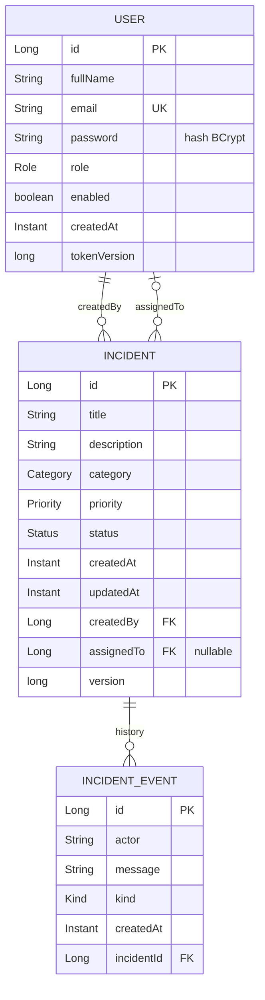

# Diagrammes de l’application

Ces diagrammes décrivent le périmètre implémenté dans le TP. Une version PDF autonome est fournie dans `output/diagrams/diagrammes_application.pdf` et l’architecture est également illustrée dans le rapport.

## Architecture générale

```mermaid
flowchart LR
    Browser["Navigateur : React"] -->|"HTTP / JSON"| Axios["Axios : Bearer JWT"]
    Axios -->|"CORS local, port 8080"| Filter["Spring Security : filtre JWT"]
    Filter --> Auth["Authentification et autorisations"]
    Auth --> Controllers["Contrôleurs REST : auth, profil, incidents, admin"]
    Controllers --> Services["Services métier / règles d’accès"]
    Services --> Repos["Repositories Spring Data JPA"]
    Repos --> H2[("H2 fichier")]
    Services --> Events["Historique et notes d’incident"]
    Events --> Repos
```

## Diagramme des entités

`createdBy` est obligatoire ; `assignedTo` reste nul tant qu’un administrateur n’a pas affecté un technicien. Un incident conserve ses changements d’état et les notes du technicien dans `IncidentEvent`. `version` sert au contrôle optimiste des modifications concurrentes.
